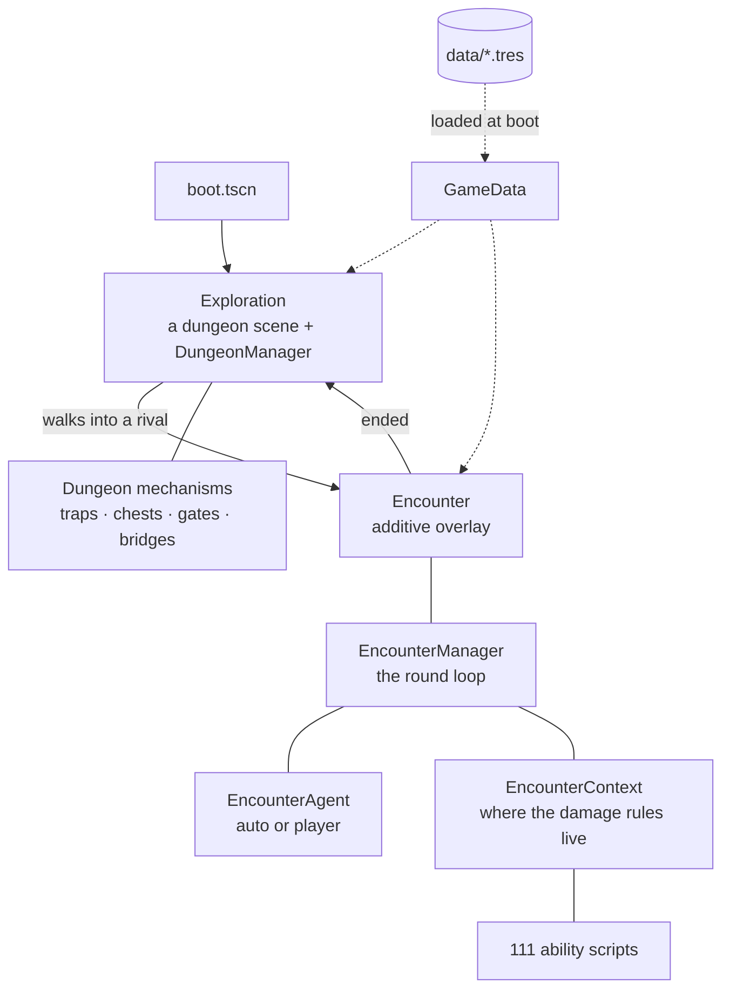

# Architecture

Three pillars — exploration, encounters, the encyclopaedia — over four autoloads and a
directory of data. This is the shape of the thing and the reasoning behind the parts that
are not obvious; [data-model.md](data-model.md) covers the data, [roadmap.md](roadmap.md)
covers what is missing.

## Data is loaded whole, assets are not

`GameData` loads **every** `.tres` at boot — species, abilities, talents, objects, dungeons.
It is a few hundred small text files, the cost is invisible once, and it buys freedom from
micro-freezes mid-dungeon.

Heavy assets are the opposite. Sprites are stored as String **paths**, never as exported
`Texture2D`, because an exported texture would be pulled into memory along with the `.tres`
that mentions it. They are preloaded per dungeon instead, from the species a given
`DungeonConfig` says can appear there.

The four autoloads: **`GameData`** (the static registry), **`GameSession`** (everything a
playthrough accumulates and that must be saved), **`SaveSystem`** (JSON),
**`TransitionManager`** (fades, scene changes, and opening encounters).

## An encounter is an overlay, not a scene change

`TransitionManager.open_encounter` instantiates `encounter.tscn` **additively** on top of
the running exploration scene, which is paused (`process_mode = DISABLED`) and stays loaded
and visible behind the 2D UI. No unload, no reload, no state to rebuild, and the dungeon
remains behind the encounter.

One consequence worth knowing: the exploration HUD lives on its own `CanvasLayer`, which
pausing does not hide, so it would sit on top of the encounter UI. `TransitionManager`
hides those layers explicitly and restores only the ones that were actually visible.

## The encounter loop, and the seam through it

`EncounterManager` runs an encounter per ROUND: everyone acts once, per-turn state is wiped
at the start, pending reordering is applied at the end.

It does not **decide** anything. Each turn it asks the individual's `EncounterAgent`:

- `AutoAgent` answers immediately, so an encounter resolves in one go without suspending.
- `UiAgent` emits `choice_requested` and awaits, so the loop suspends until a person answers.

Because the manager always does `await agent.decide(...)`, the loop is written once and
never branches on who is playing. That is what makes the whole encounter system testable
headless — `scripts/dev/encounter_check.gd` runs 108 abilities and full encounters with no
window at all, which is only possible because nothing in the loop assumes a UI.

The same seam is why `EncounterManager` deliberately knows nothing of `GameSession`.
Reaching for an autoload would tie it to a running game; instead it announces what happened
(`ifp_earned`, `object_consumed`) and the encounter UI relays it.

**Turn order is drawn at random and is load-bearing.** An individual's position — first,
in-between, last — decides which of its species' three weaknesses is currently exposed. So
reordering the turn is an attack, not a flourish, and an order fixed at "players then
rivals" would have frozen every weakness in the game.

## Effects: one script per ability, one place for the rules

Each of the 111 abilities has its own script in `scripts/encounter/effects/abilities/`,
carrying its mechanic from the design doc in the docstring. `EffectCatalog` resolves an
ability to its script by id.

An ability with no mechanic written yet falls back on **generic effects derived from its
tags** — twelve small `AbilityEffect` bricks applied in a fixed order. That is a scaffold,
never the real mechanic, and the tags are a categorisation rather than logic. Scripts still
carrying `# @unimplemented` on their first line are in that state.

Effects never touch combat state directly. Everything goes through **`EncounterContext`**,
which is where the damage modifiers, the mitigation and immunity rules, the redirection and
the logging live — written once there rather than 111 times over.

Talents are the other half, and they work differently: an ability runs at one point, a
talent REACTS to events scattered through the loop. Hence `TalentScript`'s set of hooks —
encounter start and end, a resolved Talk, a single-use ability spent, the menu being built —
of which each talent overrides only what concerns it.

Some abilities react too, within a window. An ability such as Victimism ("any rival that Talks
before the end of the turn takes damage") calls `ctx.watch_reactions()` from its `execute`, and
until its user's next turn it is handed every `EncounterEvent` — an action resolved, with the
damage it dealt, or an individual damaged — through its `react(ctx, event)`. The window is a
timed effect like the others, so it ends on the same rule. The manager sends the first kind
after each turn, `EncounterContext.deal_damage` the second; what a reaction does is announced
through `EncounterManager.reaction_noted`, and a reaction's own damage does not set off further
reactions.

Four more pieces let the other abilities say what the doc says:

- **A history.** `EncounterManager.history` (`encounter_history.gd`, handed to every context as
  `ctx.history`) records each resolved round-turn — who, what, whom, the damage, the weakness
  exposed — each real DEN loss, and each recovery or object given to someone else. "Usable only
  if…" abilities override `AbilityScript.is_usable(ctx)`; `EncounterManager.can_play` applies
  it, so the menu greys them out and `AutoAgent` leaves them alone.
- **Recurring effects.** `AbilityScript.recur(ctx)` runs at the start of each of its bearer's
  turns, and `on_meditated(ctx)` lets the bearer shake it off by Meditating (Self-Denial).
- **Weights on rival choices.** `EncounterIndividual.action_weights` raises the chance that a
  rival Talks or Meditates, on the usual timers; `AutoAgent` draws from the encounter's rng only
  when a weight applies, so an encounter without weights replays exactly as before.
- **Next-turn modifiers.** A free ability, a Talk that yields as much as an Examine, damage that
  steps up a tier, a Talk that yields less, a Meditate that is stronger (Catatonia). `ifp_earned` carries a fifth argument,
  `yield_factor`, which `GameSession.award_ifp` applies.

`EncounterContext` sits at `gdlintrc`'s ceiling on public methods, so these are static helpers
in `effects/` (`action_weights.gd`, `next_turn_modifiers.gd`, `one_off_rules.gd`) rather than
methods of the context; the next addition of that kind should follow them.

## Exploration: a logical grid, and mechanisms that register themselves

The dungeon is a **logical grid** and it is the source of truth — floor tiles, walls, holes,
occupants, edges. Nothing is decided by raycasting. `DungeonManager` holds it, in three parts:

- the **layout** (`dungeon_layout.gd`, `dungeon_manager.layout`) is what level design lays down
  and the game does not change: floor, holes, pits, the walls the grid implies, the entrance
  and the exits. It is what a dungeon authoring format will fill, and what a validator will
  check;
- the **tile searches** (`tile_search.gd`, `dungeon_manager.tile_search`) answer "a free tile
  near here", "what can be reached on foot", "a random tile to teleport to", and "make room
  here" (`push_group_aside`, which moves rivals through the manager's own `release`/`reserve`);
- the manager itself keeps what happens on the layout: who occupies which tile, the mechanisms
  registered on tiles and edges, and the turn.

The two collaborators and `safe_areas` follow one pattern — a `RefCounted` that is handed the
manager, held as a member — rather than a growing list of methods on the manager, which
`gdlintrc`'s ceiling on public methods holds in check.

A mechanism is a `Node3D` sitting on one tile that registers itself with the manager, the
same way rivals do. The base is `mechanisms/dungeon_mechanism.gd`, and the hooks are
`blocks_walk()`, `on_enter(who)`, `on_turn(turn)`, `on_tile_actions(who)`,
`on_adjacent_actions(who, facing)`, `reset_between_visits()`. Thirteen mechanisms exist on
that base: traps, gates, chests, crumbly ground, litter, refresh crystals, the dieverting
die, cracked walls, examinable decor, narrow bridges, stairs, lifts, guardrails. Gates come
in four kinds, the fourth being the teleport gate, and lifts can be linked so that stepping
onto one moves the others.

**Safe areas** are not a mechanism but a declaration: level design marks tiles in
`dungeon_manager.safe_areas` (`safe_areas.gd`), rivals never enter them, and
`safe_areas.violations()` reports a hazard (`is_hazard()`), an unrailed ledge or a spawn point
left inside one. With linked lifts and teleport gates they are the design doc's three
safeguards for an area reached by lift.

Two details that are easy to get wrong:

- Doors and guardrails sit on the **edge between two tiles**, not on a tile. They block
  crossing without costing a tile or filling the space behind them.
- A wall block can be the floor of the storey above it, so no slab is drawn on top of one.
  Walls and holes are currently DERIVED from the floor grid rather than declared, which is
  authoring debt recorded in `dungeon_layout.gd`.

Drawing is separate: `DungeonRenderer` turns the grid into meshes and reads the dungeon only
through its public API, so anything the drawing needs, the model has to name.

## The seam between the two

**A silhouette on the map is a GROUP, not an individual.** `RivalBehavior` carries its
`members` (`rival_member.gd`), each with its own variety, DEN and ETH; on the map the group
moves and decides as one. A rival placed with only `species_id` and `max_den` is a group of
one, which is what hand-built scenarios rely on.

**Going in**, exploration hands the encounter every member with its current state, so damage
taken on the map — a fall — is still there. **Coming back**, the encounter hands exploration
a report, one entry per member (`EncounterManager.rival_report`), and the group takes it:
dissolved members are gone, the others keep the DEN and ETH they came out with.

**The encounter reaches the dungeon through narrow handles, never a reference to it.**
`EncounterManager.map_reveal` is a callable handed in the way `object_provider` is, set by
`TransitionManager.open_encounter`; Trick to Reveal calls it after an effective dialogue, and
exploration answers by revealing the closest hidden chest or trap. The other direction is
Static Camouflage: `DungeonManager.scouting` (`scouting.gd`) shows 2 to 4 of the map's groups
one at a time and swaps the exploration menu for "take this group on" / "keep waiting".

An encounter no longer ends only when a side is dissolved. An individual can **leave**:
`EncounterManager.withdraw` takes it out of its side and of the turn order, so no targeting
rule, talent or ability has to know about departures. Whatever the way out — Run Away, a
smoke bomb, Ghosting, Opening up Closing — one individual leaves, and its side carries on
without it. `pacify` is the way out the
dialogue system will use — nothing calls it in play yet, the debug view's F2 does. The
outcomes follow: `victory` (every rival dissolved, the only one the FDE counter rewards),
`defeat`, `fled`, `pacified`, `rivals_fled`, `timeout`.

When the duo has fled, it lands 3 to 5 walkable steps away, and the rivals still in the
encounter stay on their tile. (A "50 % chance the rival disappears" was dropped: it looked
exactly like the whole group being devitalised.) A group still on the map after any encounter rests a few turns, or it would open the
next one straight away. The figures are in `data/balance.tres`.

Decisions taken where the design doc is silent, to revisit when it speaks:

- damage on the map reaches **every** member in full, and whether to jump after the player is
  weighed on the **weakest** member;
- a **pacified** rival leaves its group on the map;
- the rest after an encounter, and its length.

**Groups appear by the dungeon's rules**, in `DungeonConfig`: S spawn points, P groups on first
entry, N more every T turns, each composed at random X % of the time and picked from special
compositions otherwise, plus fixed groups on their own tiles. `rival_spawner.gd` applies them.
"First entry" is every entry for now, since no dungeon state survives a visit.

## The encyclopaedia: a model with no screen

`scripts/encyclopaedia/encyclopaedia_model.gd` holds the state, preloaded by `GameSession`
(`GameSession.encyclopaedia`) so that it can be unit-tested with no autoload. Per species there
are two pages, the main one and the Forlorn one, each with its own percentage:

- **IFP and fragments.** Every 3 IFP form one true fragment and one parasitic one; a page holds
  33 true fragments, so IFP stop at 99. The last percent comes only from `mark_page_assembled`,
  which the puzzle calls and which refuses unless 99 % and all 33 fragments are reported arranged.
- **Abilities.** The puzzle reports how many true fragments are correctly arranged
  (`set_arranged_fragments`); 15 reveals the first ability, 30 the second, and 15 on the Forlorn
  page reveals `forlorn_ability`. A revealed ability is stored as a tier and never taken back,
  even when fragments are later destroyed.
- **Who sees what.** `data/` lists a species' gated abilities among its origin abilities too, so
  a player character's list is `GameSession.usable_abilities(species)`: native abilities minus
  the gated ones, plus those revealed. A rival keeps all of its own. Both the encounter
  individual and the exploration catalogue read it.
- **The starting duo** is granted by the setters of `main_character` and `teammate`: 15
  arranged fragments (so 45 IFP) of each character's own species, 30 for two of one species.
- **Forlorn IFP** go to the Forlorn page once the species' main page is complete, and to the main
  page as an ordinary rival's before that (`award_ifp`).

The model does not know geometry: the puzzle owns where fragments lie and may park its layout in
a page's `puzzle_state`, which is saved untouched. `encyclopaedia_model_check` covers the lot.

## How the project tests itself

There is no test framework. Each check is a Godot scene under `scenes/dev/` whose script
asserts, prints `OK`/`FAIL` per assertion, and exits non-zero on any failure.

They are run as the **main scene**, never through `--script`: in that mode autoloads are not
registered, so scenes load *without their scripts, silently*. `tools/run_checks.sh` runs
them all, and treats three things as failure — a non-zero exit, a `push_error` on the output
even with exit 0, and a timeout, which is what a check whose script fails to compile looks
like from outside.

The encounter checks lean on one property in particular: the same seed produces the same
result, round count and encounter log. That single assertion is what makes it safe to refactor
the loop at all.
